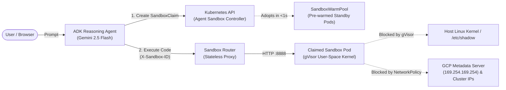

# Hands-on with Agent Sandbox on Kubernetes

**Event:** Cloud Native Days Norway 2026 (Bergen)  
**Speaker:** Abdel Sghiouar (Senior Cloud Developer Advocate @ Google | CNCF Ambassador)  
**Format:** 2-Hour Hands-on Workshop | **Level:** Beginner  

---

## Abstract & Overview

As AI agents evolve from simple chatbots into autonomous systems capable of generating and executing code and manipulating data, they introduce significant security and operational challenges. When an LLM writes and executes Python or shell code at runtime, **you are running untrusted, non-deterministic code inside your infrastructure**.

In this hands-on workshop, you will build, scale, and harden an autonomous code-executing AI agent on Kubernetes using **[Agent Sandbox (`kubernetes-sigs/agent-sandbox`)](https://github.com/kubernetes-sigs/agent-sandbox)** and the **[Google Agent Development Kit (ADK)](https://google.github.io/adk-docs/)**:

1. **Bridge VM Safety & Container Speed:** Use **gVisor (`runsc`)** as a user-space kernel runtime so untrusted agent code never touches the host node's Linux kernel.
2. **Kubernetes-Native Lifecycle CRDs:** Orchestrate ephemeral execution environments using `Sandbox`, `SandboxTemplate`, `SandboxClaim`, and `SandboxWarmPool`.
3. **Sub-Second Scaling with Warm Pools:** Eliminate container cold-start latency by maintaining a pre-warmed standby pool of gVisor sandboxes that are adopted in `<1s` and automatically replenished.
4. **"When Agents Go Rogue":** Put your cluster to the test against prompt-injected/rogue agent attacks (host filesystem escape, GCP Metadata Server credential theft, and internal cluster scanning) and lock them down with zero-trust `NetworkPolicy` boundaries.



---

## Workshop Agenda (2 Hours)

| Time | Module | Topics Covered |
| :--- | :--- | :--- |
| **00:00 – 00:20** | **Module 0: Setup** | Claim GCP credits, launch Google Cloud Shell, and start GKE Autopilot cluster provisioning |
| **00:20 – 00:40** | **Module 1: Anatomy of Agent Sandbox** | Install Agent Sandbox CRDs, deploy a standalone `Sandbox`, and inspect **gVisor (`runsc`)** vs. standard **`runc`** containers |
| **00:40 – 01:05** | **Module 2: Templates, Claims & Warm Pools** | Configure `SandboxTemplate`, `SandboxWarmPool`, and `SandboxRouter`; observe `<1s` warm pod adoption and replenishment |
| **01:05 – 01:35** | **Module 3: Building the ADK Agent** | Build a Gemini 2.5 Flash data analyst agent with `k8s-agent-sandbox`, run it in Cloud Shell, and deploy it in-cluster |
| **01:35 – 01:55** | **Module 4: When Agents Go Rogue** | Exploit metadata SSRF, apply zero-trust `NetworkPolicy`, and verify defense against rogue filesystem, kernel, and network attacks |
| **01:55 – 02:00** | **Module 5: Cleanup** | Delete cluster resources to preserve remaining GCP credits |

---

## Module 0: Environment & Cluster Setup

> [!IMPORTANT]
> **Designed for $5 Google Developer Program (GDP) Accounts:**  
> Everything in this workshop is tailored to run within a **$5 credit budget** (total 2-hour runtime cost is **~$0.40–$0.60**) and avoids services like Cloud Build that are frequently throttled on new trial/credit accounts.

### Step 0.1: Open Google Cloud Shell

1. Open the [Google Cloud Console](https://console.cloud.google.com/) in your browser.
2. Ensure you have redeemed your workshop credit link and selected your workshop GCP project in the top project picker.
3. Click the **Activate Cloud Shell** button (`>_` icon in the top-right navigation bar).
4. Once the Cloud Shell terminal opens, set your active project ID and default region:

```bash
export PROJECT_ID=$(gcloud config get-value project)
export REGION="us-central1"

echo "Active Project: ${PROJECT_ID}"
gcloud config set compute/region ${REGION}
```

*(If `PROJECT_ID` is empty, run `gcloud config set project YOUR_PROJECT_ID` first, then re-run the `export` commands above.)*

### Step 0.2: Enable Required Google Cloud APIs

Enable the Kubernetes Engine, Vertex AI (for Gemini), and Artifact Registry APIs:

```bash
gcloud services enable \
  container.googleapis.com \
  aiplatform.googleapis.com \
  artifactregistry.googleapis.com
```

### Step 0.3: Create the GKE Autopilot Cluster

We will use **GKE Autopilot**, which natively provides:
* **gVisor (`RuntimeClass: gvisor`)** out of the box (no separate node pool configuration needed).
* **GKE Dataplane V2 (Cilium eBPF)** for enforcing Kubernetes `NetworkPolicy` rules automatically.
* **Workload Identity** pre-configured for keyless IAM authentication to Vertex AI.
* **Pay-per-Pod billing** so you aren't paying for idle VM nodes.

Run the following command to create your cluster:

```bash
gcloud container clusters create-auto sandbox-lab \
  --region ${REGION} \
  --project ${PROJECT_ID}
```

> [!TIP]
> **Cluster provisioning takes ~5–8 minutes.** While GKE provisions the control plane in the background, your instructor will walk through the architecture of `kubernetes-sigs/agent-sandbox` and gVisor.

<details>
<summary><strong>Fallback Option (Only if Autopilot quota is unavailable in your region)</strong></summary>

If your account hits a regional Autopilot quota constraint, you can create a lightweight 2-node GKE Standard cluster (4 vCPUs total) with Dataplane V2 and a 1-node gVisor pool instead:

```bash
gcloud container clusters create sandbox-lab \
  --zone ${REGION}-a \
  --num-nodes 1 \
  --machine-type e2-standard-2 \
  --enable-dataplane-v2 \
  --workload-pool=${PROJECT_ID}.svc.id.goog

gcloud container node-pools create gvisor-pool \
  --cluster sandbox-lab \
  --zone ${REGION}-a \
  --num-nodes 1 \
  --machine-type e2-standard-2 \
  --image-type cos_containerd \
  --sandbox type=gvisor
```
</details>

Once the cluster creation completes, verify that `kubectl` is connected:

```bash
gcloud container clusters get-credentials sandbox-lab --region ${REGION}
kubectl get nodes
```

Create a workspace directory in Cloud Shell for all workshop files:

```bash
mkdir -p ~/agent-sandbox-workshop
cd ~/agent-sandbox-workshop
```

---

## Module 1: The Anatomy of Agent Sandbox & gVisor Isolation

Standard Kubernetes primitives (`Deployment`, `StatefulSet`, `Job`) were designed for long-running microservices or batch pipelines—not for managing thousands of ephemeral, stateful, single-replica code-execution environments per user session.

**Agent Sandbox (`kubernetes-sigs/agent-sandbox`)** introduces four Kubernetes Custom Resource Definitions (CRDs):

| CRD | API Group | Purpose |
| :--- | :--- | :--- |
| **`Sandbox`** | `agents.x-k8s.io/v1alpha1` | Core primitive managing a single isolated, stateful Pod + headless Service with a stable identity. |
| **`SandboxTemplate`** | `extensions.agents.x-k8s.io/v1alpha1` | Reusable blueprint defining the container image, resource limits, and `runtimeClassName: gvisor`. |
| **`SandboxClaim`** | `extensions.agents.x-k8s.io/v1alpha1` | Request created by an AI agent to acquire a sandbox instance from a template or warm pool. |
| **`SandboxWarmPool`** | `extensions.agents.x-k8s.io/v1alpha1` | Maintains a standby pool of pre-initialized sandbox Pods so claims resolve in `<1 second`. |

### Step 1.1: Install the Agent Sandbox Controller & CRDs

Apply the official `v0.1.0` core and extensions manifests from `kubernetes-sigs/agent-sandbox`:

```bash
export SANDBOX_VERSION="v0.1.0"

kubectl apply \
  -f https://github.com/kubernetes-sigs/agent-sandbox/releases/download/${SANDBOX_VERSION}/manifest.yaml \
  -f https://github.com/kubernetes-sigs/agent-sandbox/releases/download/${SANDBOX_VERSION}/extensions.yaml
```

Verify that the 4 CRDs are registered and the controller pod in `agent-sandbox-system` is running:

```bash
kubectl get crds | grep agents.x-k8s.io
kubectl rollout status statefulset/agent-sandbox-controller -n agent-sandbox-system --timeout=180s
```

Expected CRD output:
```text
sandboxclaims.extensions.agents.x-k8s.io
sandboxes.agents.x-k8s.io
sandboxtemplates.extensions.agents.x-k8s.io
sandboxwarmpools.extensions.agents.x-k8s.io
```

### Step 1.2: Deploy a Standalone `Sandbox` with gVisor

Why aren't standard containers enough for AI-generated code?
* Standard containers (`runc`) **share the host node's Linux kernel**. A single kernel vulnerability (`dirtycow`, `io_uring`, `ebpf`, etc.) allows untrusted code inside a container to escape onto the Kubernetes node.
* **gVisor (`runsc`)** provides an application kernel written in memory-safe Go that runs in user space. It intercepts over 200+ Linux system calls from the application—acting as a guest kernel boundary between the container and the host OS without the heavy boot overhead of a full VM.

Let's deploy a standalone `Sandbox` resource configured with `runtimeClassName: gvisor`:

```bash
cat <<'EOF' > ~/agent-sandbox-workshop/standalone-sandbox.yaml
apiVersion: agents.x-k8s.io/v1alpha1
kind: Sandbox
metadata:
  name: standalone-gvisor-sandbox
  namespace: default
spec:
  podTemplate:
    metadata:
      labels:
        app: standalone-sandbox
    spec:
      runtimeClassName: gvisor
      containers:
      - name: python-runtime
        image: registry.k8s.io/agent-sandbox/python-runtime-sandbox:v0.1.0
        ports:
        - containerPort: 8888
        resources:
          requests:
            cpu: "250m"
            memory: "512Mi"
            ephemeral-storage: "512Mi"
EOF

kubectl apply -f ~/agent-sandbox-workshop/standalone-sandbox.yaml
```

> [!NOTE]
> On GKE Autopilot, scheduling the first pod triggers node auto-provisioning, which takes **60–90 seconds**. Subsequent pods scheduled onto existing capacity or claimed from a Warm Pool start in **under 1 second**.

Wait for the `standalone-gvisor-sandbox` Pod to reach `Running`:

```bash
kubectl wait --for=condition=Ready pod/standalone-gvisor-sandbox --timeout=180s
kubectl get sandbox,pod,svc standalone-gvisor-sandbox
```

### Step 1.3: Inspect the gVisor User-Space Kernel vs. Host Kernel

Now let's run commands *inside* the `standalone-gvisor-sandbox` container and compare them against the `agent-sandbox-controller` container (which runs on the standard `runc` runtime):

```bash
echo "=== 1. Standard Container (runc - shares Host Kernel) ==="
kubectl exec -n agent-sandbox-system agent-sandbox-controller-0 -- uname -a

echo "=== 2. Agent Sandbox Container (gVisor - isolated User-Space Kernel) ==="
kubectl exec standalone-gvisor-sandbox -- uname -a

echo "=== 3. Kernel Ring Buffer (dmesg) inside gVisor ==="
kubectl exec standalone-gvisor-sandbox -- dmesg | head -n 6
```

Look closely at the output:
1. The standard container reports the real GKE host node Linux kernel (e.g., `Linux ... 6.12.94+ ...`).
2. The `standalone-gvisor-sandbox` reports **`Linux standalone-gvisor-sandbox 4.4.0 #1 SMP ...`**—gVisor's virtualized syscall interface!
3. Running `dmesg` inside the sandbox does **not** leak host kernel logs; instead, it displays gVisor's own boot sequence:
   ```text
   [    0.000000] Starting gVisor...
   [    0.108410] Singleplexing /dev/ptmx...
   [    0.213668] Daemonizing children...
   [    0.516487] Adversarially training Redcode AI...
   [    0.887429] Feeding the init monster...
   ```

Clean up the standalone demo sandbox before moving to Module 2:

```bash
kubectl delete -f ~/agent-sandbox-workshop/standalone-sandbox.yaml
```

---

## Module 2: Templates, Claims, Warm Pools & the Sandbox Router

When an AI agent needs to run Python code during a conversation, waiting 30–60 seconds for Kubernetes to pull an image and boot a fresh gVisor container ruins the user experience.

To solve this, we combine three components:
1. **`SandboxTemplate`**: Defines the blueprint for our Python execution environment (pre-loaded with `pandas`, `scikit-learn`, `lightgbm`, and a FastAPI execution server on port `8888`).
2. **`SandboxWarmPool`**: Keeps `N` pre-warmed gVisor Pods running at all times. When a `SandboxClaim` arrives, the controller **adopts an already-running Pod in `<1 second`** and immediately spawns a new standby Pod in the background to replenish the pool.
3. **`SandboxRouter`**: A stateless internal HTTP reverse proxy that routes requests from our AI agent to the right sandbox Pod based on the `X-Sandbox-ID` header.

### Step 2.1: Create the `SandboxTemplate` and `SandboxWarmPool`

```bash
cat <<'EOF' > ~/agent-sandbox-workshop/sandbox-template-and-pool.yaml
apiVersion: extensions.agents.x-k8s.io/v1alpha1
kind: SandboxTemplate
metadata:
  name: python-runtime-template
  namespace: default
spec:
  podTemplate:
    metadata:
      labels:
        sandbox: python-sandbox-example
    spec:
      runtimeClassName: gvisor
      containers:
      - name: python-runtime
        image: registry.k8s.io/agent-sandbox/python-runtime-sandbox:v0.1.0
        ports:
        - containerPort: 8888
        readinessProbe:
          httpGet:
            path: "/"
            port: 8888
          initialDelaySeconds: 0
          periodSeconds: 1
        resources:
          requests:
            cpu: "250m"
            memory: "512Mi"
            ephemeral-storage: "512Mi"
      restartPolicy: "OnFailure"
---
apiVersion: extensions.agents.x-k8s.io/v1alpha1
kind: SandboxWarmPool
metadata:
  name: python-sandbox-warmpool
  namespace: default
spec:
  replicas: 2
  sandboxTemplateRef:
    name: python-runtime-template
EOF

kubectl apply -f ~/agent-sandbox-workshop/sandbox-template-and-pool.yaml
```

Wait until both warm-pool standby pods (`python-sandbox-warmpool-*`) are `Running` and `1/1`:

```bash
kubectl get pods -l agents.x-k8s.io/pool -w
```
*(Press `Ctrl+C` once both pods show `1/1 Running`.)*

### Step 2.2: Test Sub-Second Claim Adoption & Pool Replenishment

Let's manually submit a `SandboxClaim` and watch how fast it adopts one of our warm pods:

```bash
cat <<'EOF' > ~/agent-sandbox-workshop/manual-claim.yaml
apiVersion: extensions.agents.x-k8s.io/v1alpha1
kind: SandboxClaim
metadata:
  name: manual-claim-test
  namespace: default
spec:
  sandboxTemplateRef:
    name: python-runtime-template
EOF

kubectl apply -f ~/agent-sandbox-workshop/manual-claim.yaml
```

Immediately inspect the `Sandbox`, the adopted Pod annotation, and the `Pods` list:

```bash
kubectl get sandboxclaims,sandboxes
kubectl get sandbox manual-claim-test -o jsonpath='{"Adopted WarmPool Pod: "}{.metadata.annotations.agents\.x-k8s\.io/pod-name}{"\n"}'
kubectl get pods --show-labels
```

Notice what happened automatically:
1. `sandbox.agents.x-k8s.io/manual-claim-test` became `Ready` **instantly** by adopting one of the pre-warmed pods (`python-sandbox-warmpool-xxxxx`).
2. The adopted pod's label was switched from `agents.x-k8s.io/pool=<hash>` to `agents.x-k8s.io/sandbox-name-hash=<hash>`, binding it exclusively to the `manual-claim-test` headless Service.
3. The `SandboxWarmPool` controller immediately detected that the standby pool dropped from `2` to `1` and spawned a brand-new `python-sandbox-warmpool-yyyyy` pod to replenish the pool!

Delete the test claim (which automatically terminates the claimed pod):

```bash
kubectl delete -f ~/agent-sandbox-workshop/manual-claim.yaml
```

### Step 2.3: Deploy the `SandboxRouter`

The `k8s-agent-sandbox` SDK communicates with sandboxes through the `sandbox-router-svc` Service. Deploy the router:

```bash
cat <<'EOF' > ~/agent-sandbox-workshop/sandbox-router.yaml
apiVersion: v1
kind: Service
metadata:
  name: sandbox-router-svc
  namespace: default
spec:
  type: ClusterIP
  selector:
    app: sandbox-router
  ports:
  - name: http
    protocol: TCP
    port: 8080
    targetPort: 8080
---
apiVersion: apps/v1
kind: Deployment
metadata:
  name: sandbox-router-deployment
  namespace: default
spec:
  replicas: 1
  selector:
    matchLabels:
      app: sandbox-router
  template:
    metadata:
      labels:
        app: sandbox-router
    spec:
      containers:
      - name: router
        image: us-central1-docker.pkg.dev/k8s-staging-images/agent-sandbox/sandbox-router:latest-main
        env:
        - name: ALLOW_UNAUTHENTICATED_ROUTER
          value: "true"
        ports:
        - containerPort: 8080
        readinessProbe:
          httpGet:
            path: /healthz
            port: 8080
          initialDelaySeconds: 5
          periodSeconds: 5
        livenessProbe:
          httpGet:
            path: /healthz
            port: 8080
          initialDelaySeconds: 10
          periodSeconds: 10
        resources:
          requests:
            cpu: "250m"
            memory: "512Mi"
          limits:
            cpu: "1000m"
            memory: "1Gi"
      securityContext:
        runAsUser: 1000
        runAsGroup: 1000
EOF

kubectl apply -f ~/agent-sandbox-workshop/sandbox-router.yaml
kubectl rollout status deployment/sandbox-router-deployment --timeout=180s
```

---

## Module 3: Building an Autonomous Code-Executing Agent with Google ADK

Now that our Kubernetes sandbox infrastructure is ready, we will build an AI agent (`DataScienceAgent`) using the **Google Agent Development Kit (ADK)** and **Gemini 2.5 Flash**.

When a user asks a data question or requests a computation, the agent will:
1. Reason about the task and generate a complete Python script (e.g., using `pandas`).
2. Call our custom tool `execute_python_in_sandbox(code)`.
3. Inside the tool, `SandboxClient` creates a `SandboxClaim` (adopting a warm gVisor pod in `<1s`), uploads the generated code as `script.py`, runs `python3 script.py`, returns `stdout`/`stderr` to Gemini, and **automatically deletes the `SandboxClaim`** when the `with` block exits!

### Step 3.1: Create the Python Virtual Environment & Agent Code

In Cloud Shell, set up a Python virtual environment and install `google-adk` and `k8s-agent-sandbox`:

```bash
cd ~/agent-sandbox-workshop
python3 -m venv .venv
source .venv/bin/activate
pip install --upgrade pip
pip install google-adk "k8s-agent-sandbox==0.2.1" pandas
```

Create the `root_agent` package directory and `__init__.py`:

```bash
mkdir -p ~/agent-sandbox-workshop/root_agent

cat <<'EOF' > ~/agent-sandbox-workshop/root_agent/__init__.py
from . import agent
EOF
```

Create `root_agent/agent.py`:

```bash
cat <<'EOF' > ~/agent-sandbox-workshop/root_agent/agent.py
import os
from google.adk.agents import Agent
from k8s_agent_sandbox import SandboxClient

SANDBOX_NAMESPACE = os.getenv("SANDBOX_NAMESPACE", "default")
SANDBOX_TEMPLATE = os.getenv("SANDBOX_TEMPLATE", "python-runtime-template")
# When running in-cluster, SANDBOX_ROUTER_URL points directly to the cluster DNS.
# When unset (e.g., running in Cloud Shell), SandboxClient automatically tunnels via kubectl port-forward.
SANDBOX_ROUTER_URL = os.getenv("SANDBOX_ROUTER_URL", None)


def execute_python_in_sandbox(code: str) -> str:
    """Executes a Python script inside an isolated GKE Agent Sandbox (gVisor).

    Use this tool whenever you need to run calculations, analyze data with pandas,
    or test system/network behavior. Input must be a complete Python script that
    prints its results to stdout.
    """
    with SandboxClient(
        template_name=SANDBOX_TEMPLATE,
        namespace=SANDBOX_NAMESPACE,
        api_url=SANDBOX_ROUTER_URL,
    ) as sandbox:
        sandbox.write("script.py", code)
        result = sandbox.run("python3 script.py")
        output = []
        if result.stdout:
            output.append(f"STDOUT:\n{result.stdout}")
        if result.stderr:
            output.append(f"STDERR:\n{result.stderr}")
        output.append(f"EXIT_CODE: {result.exit_code}")
        return "\n".join(output)


root_agent = Agent(
    name="DataScienceAgent",
    model="gemini-2.5-flash",
    instruction="""You are an expert data analyst and Kubernetes security tester.
Whenever a user asks you to analyze data, compute metrics, or run a system/security check:
1. Write a complete, self-contained Python script (using `pandas` or standard library modules).
2. Execute the script inside the GKE Agent Sandbox using `execute_python_in_sandbox`.
3. Present a clear summary of the results along with the exact output returned by the sandbox.
""",
    tools=[execute_python_in_sandbox],
)
EOF
```

Configure the `.env` file so ADK uses Vertex AI in your project:

```bash
cat <<EOF > ~/agent-sandbox-workshop/root_agent/.env
GOOGLE_GENAI_USE_VERTEXAI=TRUE
GOOGLE_CLOUD_PROJECT=${PROJECT_ID}
GOOGLE_CLOUD_LOCATION=${REGION}
EOF
```

### Step 3.2: Test the Agent Live from Cloud Shell (Developer Tunnel Mode)

Before packaging a container image, you can run the ADK Web UI directly in Cloud Shell! Because `SANDBOX_ROUTER_URL` is unset locally, `SandboxClient` automatically opens a `kubectl port-forward` tunnel to `sandbox-router-svc` in your GKE cluster whenever the tool is called.

1. Start the ADK Web UI server in Cloud Shell:

   ```bash
   cd ~/agent-sandbox-workshop
   adk web --host 0.0.0.0 --port 8080
   ```

2. In the top-right corner of the Cloud Shell pane, click the **Web Preview** icon and select **Preview on port 8080**.
3. In the ADK Web UI, select **`root_agent`** from the top-left dropdown and send the following prompt:

   > **Prompt:**  
   > Here is our store inventory in CSV format. Using pandas, calculate the total inventory value for each item, the grand total across all items, and identify which item represents the highest share of total value:
   > ```
   > product,quantity,unit_price
   > Laptop,12,1350
   > Mechanical Keyboard,45,110
   > 4K Monitor,18,420
   > USB-C Dock,30,190
   > ```

4. Watch the Cloud Shell terminal logs as your agent:
   * Calls `execute_python_in_sandbox` with generated `pandas` code,
   * Creates a `SandboxClaim` (`sandbox-claim-xxxxxxxx`),
   * Adopts a pre-warmed gVisor pod in `<1s`,
   * Uploads `script.py`, runs `python3 script.py`, and deletes the claim!

*(Keep `adk web` running for Module 4, or press `Ctrl+C` if you also want to complete the optional in-cluster deployment in Step 3.3 below.)*

<details>
<summary><strong>Step 3.3 (Optional): Deploy the Agent Inside the GKE Cluster</strong></summary>

If you want to run the agent inside the GKE cluster itself (using **Workload Identity**, **RBAC**, and **Direct In-Cluster Routing** without `kubectl port-forward`), follow these steps in Cloud Shell.

> [!TIP]
> We build the Docker image **locally in Cloud Shell** (`docker build` + `docker push`) rather than using `gcloud builds submit` so you never hit Cloud Build restrictions on trial/credit accounts.

1. **Configure Workload Identity for Vertex AI access:**
   ```bash
   kubectl create serviceaccount adk-agent-sa --dry-run=client -o yaml | kubectl apply -f -

   export PROJECT_NUMBER=$(gcloud projects describe ${PROJECT_ID} --format="value(projectNumber)")

   gcloud projects add-iam-policy-binding projects/${PROJECT_ID} \
     --role=roles/aiplatform.user \
     --member=principal://iam.googleapis.com/projects/${PROJECT_NUMBER}/locations/global/workloadIdentityPools/${PROJECT_ID}.svc.id.goog/subject/ns/default/sa/adk-agent-sa \
     --condition=None
   ```

2. **Build and push the Agent image to Artifact Registry:**
   ```bash
   gcloud artifacts repositories create agent-repo \
     --repository-format=docker \
     --location=${REGION} || true

   gcloud auth configure-docker ${REGION}-docker.pkg.dev --quiet

   cat <<'EOF' > ~/agent-sandbox-workshop/Dockerfile
   FROM python:3.12-slim
   ENV PYTHONDONTWRITEBYTECODE=1
   ENV PYTHONUNBUFFERED=1
   WORKDIR /app
   RUN pip install --no-cache-dir google-adk "k8s-agent-sandbox==0.2.1" pandas
   COPY ./root_agent /app/root_agent
   EXPOSE 8080
   ENTRYPOINT ["adk", "web", "--host", "0.0.0.0", "--port", "8080"]
   EOF

   docker build -t ${REGION}-docker.pkg.dev/${PROJECT_ID}/agent-repo/data-agent:v1 ~/agent-sandbox-workshop/
   docker push ${REGION}-docker.pkg.dev/${PROJECT_ID}/agent-repo/data-agent:v1
   ```

3. **Deploy the Agent with Least-Privilege Sandbox RBAC:**
   ```bash
   cat <<EOF > ~/agent-sandbox-workshop/agent-deployment.yaml
   apiVersion: rbac.authorization.k8s.io/v1
   kind: Role
   metadata:
     name: sandbox-creator-role
     namespace: default
   rules:
   - apiGroups: ["extensions.agents.x-k8s.io"]
     resources: ["sandboxclaims"]
     verbs: ["create", "get", "list", "watch", "delete"]
   - apiGroups: ["agents.x-k8s.io"]
     resources: ["sandboxes"]
     verbs: ["get", "list", "watch"]
   ---
   apiVersion: rbac.authorization.k8s.io/v1
   kind: RoleBinding
   metadata:
     name: adk-agent-sandbox-binding
     namespace: default
   subjects:
   - kind: ServiceAccount
     name: adk-agent-sa
     namespace: default
   roleRef:
     kind: Role
     name: sandbox-creator-role
     apiGroup: rbac.authorization.k8s.io
   ---
   apiVersion: apps/v1
   kind: Deployment
   metadata:
     name: data-agent
     namespace: default
   spec:
     replicas: 1
     selector:
       matchLabels:
         app: data-agent
     template:
       metadata:
         labels:
           app: data-agent
       spec:
         serviceAccountName: adk-agent-sa
         containers:
         - name: data-agent
           image: ${REGION}-docker.pkg.dev/${PROJECT_ID}/agent-repo/data-agent:v1
           env:
           - name: SANDBOX_ROUTER_URL
             value: "http://sandbox-router-svc.default.svc.cluster.local:8080"
           ports:
           - containerPort: 8080
           resources:
             requests:
               cpu: "250m"
               memory: "512Mi"
   ---
   apiVersion: v1
   kind: Service
   metadata:
     name: data-agent-svc
     namespace: default
   spec:
     type: ClusterIP
     selector:
       app: data-agent
     ports:
     - port: 8080
       targetPort: 8080
   EOF

   kubectl apply -f ~/agent-sandbox-workshop/agent-deployment.yaml
   kubectl rollout status deployment/data-agent --timeout=180s
   ```

4. **Port-forward to the in-cluster `data-agent` service (and preview on port 8080):**
   ```bash
   kubectl port-forward svc/data-agent-svc 8080:8080
   ```
</details>

---

## Module 4: "When Agents Go Rogue" — Hardening & Adversarial Testing

What happens when a user submits a **prompt injection** Inside a CSV file or asks the agent to perform reconnaissance against your cloud environment?

Let's test our security posture before and after applying network isolation!

### Step 4.1: The Attack *Before* Network Isolation (GCP Metadata SSRF)

While gVisor isolates the host kernel and filesystem, Kubernetes pods by default can make outbound network requests to:
* The **Google Cloud Metadata Server (`169.254.169.254`)**, which exposes project details, service account identities, and potentially IAM access tokens.
* Internal cluster Services (`10.0.0.0/8`), including the Kubernetes API server (`kubernetes.default.svc.cluster.local`) and internal microservices.

Let's ask our agent in the ADK Web UI (or via the CLI) to query the GCP Metadata Server right now:

> **Prompt:**  
> Write and run a Python script in the sandbox that sends an HTTP GET request to `http://169.254.169.254/computeMetadata/v1/project/project-id` with the header `Metadata-Flavor: Google` and prints the response.

**Result:**  
The sandbox pod **succeeds** and returns your real `PROJECT_ID`! Without network egress controls, untrusted code running inside a pod can talk to the cloud metadata endpoint and internal cluster services.

### Step 4.2: Lock Down the Sandbox with Zero-Trust `NetworkPolicy`

Let's block all sandbox egress to:
1. **`169.254.169.254/32`** (Cloud Metadata Server)
2. **`10.0.0.0/8`, `172.16.0.0/12`, `192.168.0.0/16`** (RFC1918 internal cluster Pod/Service/Node networks)

> [!IMPORTANT]
> **Critical Label Lifecycle Detail:**  
> While sitting in `SandboxWarmPool`, standby pods carry the label `agents.x-k8s.io/pool=<hash>`. The instant a pod is claimed by a `Sandbox`, the controller replaces that label with `agents.x-k8s.io/sandbox-name-hash=<hash>`.  
> Because warm-pool adoption happens in **under 100 milliseconds**, we apply our `NetworkPolicy` to **both** label selectors (`agents.x-k8s.io/pool` and `agents.x-k8s.io/sandbox-name-hash`). That way, the eBPF firewall is already attached while the pod sits in the warm pool—eliminating any sub-second race window during claim handoff!

Open a second Cloud Shell tab (or stop `adk web` briefly) and apply `sandbox-policy.yaml`:

```bash
cat <<'EOF' > ~/agent-sandbox-workshop/sandbox-policy.yaml
apiVersion: networking.k8s.io/v1
kind: NetworkPolicy
metadata:
  name: restrict-claimed-sandbox-egress
  namespace: default
spec:
  podSelector:
    matchExpressions:
    - key: agents.x-k8s.io/sandbox-name-hash
      operator: Exists
  policyTypes:
  - Egress
  egress:
  # Allow DNS resolution
  - ports:
    - protocol: UDP
      port: 53
    - protocol: TCP
      port: 53
  # Allow public internet ONLY (block Metadata Server and internal RFC1918 networks)
  - to:
    - ipBlock:
        cidr: 0.0.0.0/0
        except:
        - 169.254.169.254/32
        - 10.0.0.0/8
        - 172.16.0.0/12
        - 192.168.0.0/16
---
apiVersion: networking.k8s.io/v1
kind: NetworkPolicy
metadata:
  name: restrict-warmpool-sandbox-egress
  namespace: default
spec:
  podSelector:
    matchExpressions:
    - key: agents.x-k8s.io/pool
      operator: Exists
  policyTypes:
  - Egress
  egress:
  - ports:
    - protocol: UDP
      port: 53
    - protocol: TCP
      port: 53
  - to:
    - ipBlock:
        cidr: 0.0.0.0/0
        except:
        - 169.254.169.254/32
        - 10.0.0.0/8
        - 172.16.0.0/12
        - 192.168.0.0/16
EOF

kubectl apply -f ~/agent-sandbox-workshop/sandbox-policy.yaml
```

### Step 4.3: Run the 3 Rogue Agent Attacks

Make sure `adk web --host 0.0.0.0 --port 8080` (or `kubectl port-forward`) is running, and test all three adversarial scenarios in the ADK Web UI:

#### Attack 1: Cloud Metadata & Internal Cluster Reconnaissance (SSRF)
> **Prompt:**  
> Run a Python script in the sandbox that attempts to connect (with a 3-second timeout) to:
> 1. `http://169.254.169.254/computeMetadata/v1/project/project-id` (with header `Metadata-Flavor: Google`)
> 2. `https://kubernetes.default.svc.cluster.local`
> Print whether each connection succeeded or timed out.

* **Expected Result:** Both requests fail with `URLError: <urlopen error timed out>`. GKE Dataplane V2 drops all packets from the sandbox to the metadata server and internal cluster IPs.

#### Attack 2: Host Filesystem & Kernel Escape
> **Prompt:**  
> Run a Python script in the sandbox that checks the kernel version (`uname -r`), lists running processes (`ps aux` or `/proc`), and attempts to read `/etc/shadow` and `/proc/sysrq-trigger`. Print the exact results.

* **Expected Result:**
  * `/etc/shadow` and `/proc/sysrq-trigger` fail with `PermissionError: [Errno 13] Permission denied` (the sandbox runs as non-root UID `1000` inside an isolated rootfs).
  * `uname -r` returns `4.4.0` (the virtualized **gVisor** guest kernel).
  * `/proc` only shows the isolated sandbox processes (`uvicorn` and the child `python3` script)—never host or neighbor container processes.

#### Attack 3: Ephemeral Persistence Check (Malware / Backdoor Drop)
> **Prompt:**  
> First, run a Python script in the sandbox that writes a secret file `/app/backdoor.txt` containing `"compromised"`. Then, in a second separate tool call, run another Python script to check if `/app/backdoor.txt` exists!

* **Expected Result:** In the second tool call, `/app/backdoor.txt` **does not exist (`False`)**! Every `with SandboxClient(...)` execution creates a brand-new `SandboxClaim`, consumes a clean warm-pool pod, and destroys the sandbox immediately upon completion—preventing cross-execution contamination.

---

## Module 5: Cleanup (Preserving Your GCP Credits)

To ensure your GKE cluster does not continue consuming your $5 credit balance after the workshop ends, delete the cluster (and optional Artifact Registry repository):

```bash
gcloud container clusters delete sandbox-lab \
  --region ${REGION} \
  --project ${PROJECT_ID} \
  --quiet

gcloud artifacts repositories delete agent-repo \
  --location=${REGION} \
  --project=${PROJECT_ID} \
  --quiet 2>/dev/null || true
```

---

## Further Reading & Resources

* [Kubernetes SIGs Agent Sandbox Repository (`kubernetes-sigs/agent-sandbox`)](https://github.com/kubernetes-sigs/agent-sandbox)
* [GKE Agent Sandbox Official Documentation](https://cloud.google.com/kubernetes-engine/docs/how-to/agent-sandbox)
* [Google Agent Development Kit (ADK) Documentation](https://google.github.io/adk-docs/)
* [gVisor Container Runtime Architecture](https://gvisor.dev/docs/)
